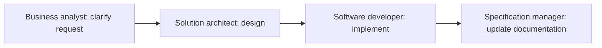

# Activity transcript

## Source:

{
  "source_session_id": "01a1d151-7046-7d83-89ee-573c30ee6685",
  "durable_path": "C:\\Users\\hmhri\\.codex\\sessions\\2026\\11\\12\\rollout-2026-11-12T21-52-18-01a1d151-7046-7d83-89ee-573c30ee6685.jsonl",
  "original_started_at": "2026-11-12T19:52:18.056Z",
  "activity_id": "1b440d51-819b-4299-862b-0182f0f4fca5",
  "representation": "event_msg",
  "assigned_start": 52,
  "assigned_end": null,
  "last_verified_source_position": 156,
  "enabled_intervals": [
    {
      "start": {
        "source_session_id": "01a1d151-7046-7d83-89ee-573c30ee6685",
        "source_position": 52
      },
      "end": null,
      "provenance": "Chronicles enabled before observed workflow research work prompt"
    }
  ]
}

## Prompt:

I want to explore the idea along with the agents the framework to have another functionality - workflows. A workflow should define a process, set of steps which one or several agents should perform in coordination and dependency from each other. I am not sure if this idea is good and how to realize it, so I need your advise, I need you to check the best practices. Make independent recomendation from user perspective, HAI integrity perspective, future scalability perspective, maintainability perspective. Research if similar products have such or close to this functionality and how this is realized there. Be critical. 

## Outcome:

I used Exa to review 27 search results across three research angles, then examined selected official documentation and HAI’s current contracts.

**My recommendation: workflows are a good direction for HAI, provided they remain optional and begin as a small coordination layer.** Build toward explicit, resumable handoffs; first prove that they improve real work enough to justify another maintained abstraction.

The detailed assessment is saved in [workflows-assessment.md](/C:/Users/hmhri/Desktop/repos/haide/.hai_env/activities/00000000_000000_active/results/workflows-assessment.md).

**What the idea would add**

HAI already has most of the ingredients: agents, role-owned procedures, host coordination, Activity records, invocation folders and shared chat. The missing capability is a reusable contract connecting them:

> Given these inputs, perform these steps, pass these outputs to the next participants, and establish completion through this evidence.

That could let a user request “assess this change for release” without remembering which roles to select or how to coordinate them.

The critical distinction is between **reusable instructions** and **enforced execution semantics**. A Markdown checklist offers convenience. Reliable dependency tracking, interruption recovery and evidence validation constitute a substantially larger feature.

**What comparable products do**

| Product | How it realizes workflows | Relevant lesson |
|---|---|---|
| Windsurf/Cascade | Repository Markdown files describe step sequences invoked through slash commands. | Simple authoring and sharing can deliver value without a complex engine. |
| Claude Code | Dynamic workflows place orchestration in JavaScript scripts executed by its host runtime. | Repeatable coordination requires more than reusable agent instructions. |
| CrewAI | Flows connect methods and crews through explicit routing, state and optional persistence. | Separate process coordination from the specialists doing the work. |
| LangGraph | Graphs define state, nodes and dependencies, with checkpoints and human interrupts. | Resumption and branching need precise runtime semantics. |
| GitHub Agentic Workflows | Markdown and configuration compile into Actions workflows; controlled jobs execute declared outputs. | Separate proposed actions from their execution authority. |
| Temporal | Durable execution coordinates operations and recovery across failures. | Recovery must account for operations that succeeded before their result was recorded. |

Sources: [Windsurf](https://docs.devin.ai/windsurf/plugins/cascade/workflows), [Claude Code](https://code.claude.com/docs/en/workflows), [CrewAI](https://docs.crewai.com/en/concepts/flows), [LangGraph](https://docs.langchain.com/oss/python/langgraph/graph-api), [GitHub](https://docs.github.com/en/copilot/concepts/agent-capabilities/agent-powered-workflows-and-operations/about-github-agentic-workflows), [Temporal](https://docs.temporal.io/activity-definition).

Their existence validates the general concept. It does **not** establish that HAI needs their full complexity.

**Assessment from your four perspectives**

| Perspective | Strongest benefit | Main concern | Recommendation |
|---|---|---|---|
| User | Request an outcome without managing every agent handoff. | Rigid processes can turn small tasks into expensive ceremonies. | Keep workflows optional, previewable and adaptable. |
| HAI integrity | Make coordination explicit and inspectable. | Duplicate ownership of lifecycle, permissions, procedures or completion. | Workflows compose existing contracts; Activities retain lifecycle ownership. |
| Future scalability | Reuse proven processes across tasks and teams. | Background execution and parallel writers require capabilities HAI does not currently provide. | Preserve an integration boundary; expand execution scope separately. |
| Maintainability | Maintain a process once instead of repeating instructions. | Definitions drift from agents, procedures and available tools. | Use a small schema, explicit bindings and versioned run snapshots. |

A particularly important repository finding: **HAI’s runtime does not currently invoke agents, and HAI permits only one current Activity.** Its host helper checks supplied capability evidence. Therefore, adding workflow files would not itself establish scheduling, unattended execution or concurrent independent projects.

There is also a terminology issue: HAI already describes a procedure as an agent-owned workflow. A new first-class concept should clearly distinguish **work inside a role** from **coordination across role calls**.

**How I would realize it**

Use three concepts:

1. **Workflow definition:** a reusable process containing inputs, steps, role/procedure references, dependencies, output bindings and completion criteria.
2. **Workflow run:** an execution of a pinned definition within an Activity, retaining attempts, results and evidence.
3. **Host coordinator:** selects eligible work and executes or delegates it through HAI’s existing permission, capability, allocation and recording contracts.

A workflow step should not automatically mean a separate agent instance. One agent may perform several steps; separate execution remains necessary where independence is required.

Start with manual invocation, sequential steps, explicit handoffs, inspectable progress, pause/resume and clear failure reporting. Defer general scripting, nested workflows, schedules, unrestricted loops and parallel writers.

**The difficult part is failure handling**

Before calling the feature reliable, HAI must answer questions such as:

- If a producer is skipped, can its consumer still run?
- If implementation changes after review, which results become stale?
- If an agent disappears, how is its attempt reconciled?
- If an external action succeeds immediately before a crash, how does resumption avoid repeating it?
- If a workflow or procedure changes mid-run, which version governs continuation?

Checkpointing alone does not solve these problems. LangGraph documents that interrupted nodes restart from their beginning; Temporal documents cases where an operation executes successfully but its completion is not recorded. Safe retries require additional design. [LangGraph interrupts](https://docs.langchain.com/oss/python/langgraph/interrupts), [Temporal idempotency](https://docs.temporal.io/activity-definition).

**My strongest criticism of the idea**

If workflows merely encode “analyst → architect → developer → QA” for every task, they may formalize unnecessary overhead. More agents do not inherently produce better results, and a reusable sequence does not guarantee correct handoffs or independent verification.

Anthropic’s engineering guidance recommends increasing complexity only when evaluation justifies it. That is the appropriate standard here. [Building effective agents](https://www.anthropic.com/research/building-effective-agents).

I would first pilot **a read-only change assessment** and **a release-readiness assessment**, using Activity plans to record their steps. Compare them against ordinary host coordination on missed handoffs, user interventions, interruption recovery, latency, token usage and accepted result quality.

If the pilots improve those outcomes, add runtime enforcement. If they merely restate a plan, retain lightweight reusable instructions.

No framework implementation was changed. The report records proposals and limitations; this was direct research, without a separate agent review or competitor execution.

## Prompt:

The main idea is to mimic a real company, where a standard procedures are defined which include several employee roles to do certain tasks in a specific order. For example when a customer issues a request, first the request is clarified by the business analyts, then the clarified request goes to the solution architect for creation of a design, then goes to the software developer for execution and at the end to the specification manager for update of the documentation. In other instances there could be other agents involved for different workflow. Does this changes your point of view and proposal

## Outcome:

**Yes—it strengthens the case for workflows as a first-class HAI concept.** Your intent is to define how the organization operates: agents represent employee roles, and workflows define how responsibility moves between those roles.

My earlier proposal emphasized execution reliability too heavily. For your use case, the primary value is **consistent organizational process**; tracking and recovery support that value.

I would distinguish the concepts this way:

| Concept | Company equivalent | HAI responsibility |
|---|---|---|
| Agent | Employee role | Expertise, responsibilities and authority |
| Procedure | Instructions for performing a role’s task | How that role performs its part |
| Workflow | Cross-functional business process | Who acts, in what order, and what each handoff requires |
| Activity | A particular customer request or assignment | Actual inputs, decisions, work and outcome |
| Workflow run | That request following a particular process | Progress and evidence for each step |

Under this interpretation, a workflow deserves its own definition rather than being buried in one agent’s instructions. No individual specialist should own the entire company process; the host coordinates it.

Your example would become:

The important addition is an explicit **handoff contract**. “The architect acts after the analyst” is insufficient by itself. The workflow should identify:

- What the analyst delivers and what makes it ready for design.
- Which design outputs the developer needs.
- What implementation evidence the specification manager receives.
- What happens when a recipient finds missing information or a contradiction.

This is where mimicking a company becomes useful: a recipient can return work for clarification instead of pretending that completion of the previous step guarantees readiness.

**I would revise the proposal in three ways.**

1. **Make reusable cross-role workflows an intended HAI capability.** Their purpose is broader than saving prompts: they encode operating processes that users can inspect, select and improve.
2. **Start with human-readable definitions and recorded handoffs.** A host can follow the process using existing agents and Activities. A scheduler or autonomous execution engine is not a prerequisite.
3. **Define process governance early.** Each workflow needs an owner, version, applicability, participating roles, handoffs, completion criteria and permitted exceptions. An Activity records the version it follows and any justified deviation.

I would still challenge two aspects of the company analogy.

First, **a role boundary need not imply a new agent instance**. Separate execution helps when context isolation or independent judgment matters, but spawning a fresh agent for every organizational box can introduce unnecessary cost.

Second, **the process must permit feedback**. Real work rarely follows a perfect forward sequence. The developer may discover an architectural problem; documentation may expose an unresolved requirement. Support explicit returns and retained decisions, even if the first implementation coordinates those returns manually.

Your example also exposes two policy choices:

- Verification is absent. For consequential implementation, developer checks and independent verification should occur before the work is considered complete, consistent with HAI’s existing requirements.
- Specification-manager at the end is appropriate for documenting the delivered result, but agreed requirements and design still need recording earlier. The final update should reconcile intended and actual behavior.

**The revised direction is therefore: build workflows as HAI’s reusable organizational processes, with the host acting as process coordinator.** Keep agents responsible for their specialist work and Activities responsible for the particular assignment’s history. Prove that model with one customer-request workflow before investing in a more sophisticated execution engine.

## Prompt:

The workflows should clearly specify the expected input and outputs with their naming standards and locations. Each step should be an instruction to an agent what to do. There should be ability what to happen in case of success or failure of the step. And the workflow should be stored in one or more files with predefined structure. Workflows should be executed in the boundaries of a single activity - no cross-activity workflows. But one activity can have several workflows executed in them. The workflow metadata and status data should be stored in the .hai_env/ folder subfolder - like the files related to agents.

