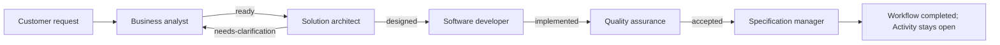

# Workflow design package — review draft 0.3

Revised: 2026-11-15 (user review of the guide). Activity: `1b440d51-819b-4299-862b-0182f0f4fca5`.
Status: **proposed, not approved for implementation**.

This package describes the entire proposed first version. Runtime commands,
directories and manager capabilities below are proposals, not installed features.
All examples and traces are illustrative, not evidence of executed workflows.

## Read in this order

1. [Requirements and acceptance](01-requirements.md): your requirements and proposed scope boundaries.
2. [Solution specification](02-solution-specification.md): exact format, file references, state, transitions, recovery and interfaces.
3. [Worked examples](03-worked-examples.md): full definitions, concrete paths, artifact samples and traces.
4. [Manager design](04-manager-design.md): responsibilities, procedures and validation ownership.
5. [Implementation plan](05-implementation-plan.md): affected resources, verification and staged delivery.

## Proposed solution at a glance

An optional named process lives in `.hai_env/workflows/<name>.md`. A host starts
an execution inside the sole current Activity, snapshots that definition and its
initial inputs, and follows one control path at a time. Each step is an instruction
to a registered agent. Accepted named results choose the next step or a declared
terminal outcome. Results always have file evidence; unknown or invalid results
cannot advance the process. The definition manager owns authoring and review;
core owns validation/persistence; the host owns actual dispatch and coordination.



The diagram omits other terminal branches; the complete example defines every
result and its evidence. Rework is bounded and retained, not an implicit restart.

## Decisions reviewed with the user

| Topic | Current decision | Status |
| --- | --- | --- |
| Machine-readable structure | One Markdown file with YAML metadata. The precise YAML fields/subset remain part of the detailed format draft for later review. | General approach confirmed. |
| Run storage | Use a dedicated environment folder, proposed as `.hai_env/workflow-runs/<activity-id>/<run-id>/`, separate from general Activity working files. Runs retain their owning Activity ID even after that Activity is archived. | Dedicated environment storage confirmed; concrete path reflected in this draft. |
| Shared registration | A definition file in `.hai_env/workflows/` is sufficient for discovery/registration; no separate catalogue. Validation is still required before execution. | Confirmed. |
| Artifact contracts | Each run has its own folder; every step attempt has its own fixed output locations inside that run. | Confirmed. |
| Evidence formats | No format or extension whitelist. The workflow author declares the expected format and how it must be checked. This includes text, structured data, binary files and folders when specified. | Earlier restriction removed as requested. |
| Coordination | Several runs may belong to one Activity, but only one executes at a time. Preparation reserves that execution slot. | Confirmed. |
| Result logic | A step may define many possible results. Each completed attempt reports one final result, with its required artifacts, and follows that result's next-step instruction. | Confirmed by the user on 2026-11-15. |
| Loops | A workflow can explicitly return to an earlier step for clarification or correction. Each workflow defines per-step and total-run attempt limits. | Return transitions and the limit proposal were confirmed by the user on 2026-11-15; example values are illustrative. |
| Agent manager placement | Maintain the manager's canonical reusable package in `hai_agents_library/agents/workflow-definition-manager/`; install/register a workspace copy through existing runtime operations when implementation is authorized. | Golden-library inclusion confirmed. |

These decisions update the design, not implementation authority. They do not approve
unreviewed details elsewhere in the package.

## Result logic, in plain language

Consider the solution architect's step:

| Architect's final result | Required output | What happens next |
| --- | --- | --- |
| designed | A solution design file. | Give it to the developer. |
| needs-clarification | A file containing the existing clarified requirements and the new questions. | Give it back to the business analyst. |
| declined | A file explaining why the request cannot proceed. | Finish this workflow with that reason. |

The workflow author can define as many such results as the process needs. The
accepted rule is that **one attempt finishes with one final result**, so the coordinator
knows which instruction to follow next. The agent reports that result; the host
coordinator checks its required files and stated conditions before proceeding.
This does not mean you approve every step manually, or that a result can have only
one file. For example `designed-with-warnings` could require both a design and a
warnings file and still select one next step.

If the agent reports several conflicting final results, or the file evidence does
not support the chosen result, the coordinator stops that transition instead of
choosing arbitrarily. The user accepted this one-result-per-attempt rule on 2026-11-15. Support for
following multiple next steps would be a different design.

## Returning to an earlier step, in plain language

A "back-edge" simply meant a result that sends the work to an earlier step:

```text
Business analyst -> Solution architect -> Software developer
                         |
                         +-- needs clarification -> Business analyst
```

The analyst answers the questions and produces revised requirements; the architect
then makes another attempt using those revised requirements. Each attempt gets a
new output folder, so old files remain intact. It is not a restart of the entire run.

The accepted limit proposal provides safeguards such as "at most three attempts for this step" and
"at most twelve attempts across this run." Those numbers belong to the example,
not fixed framework limits. If a limit is reached, the coordinator reports that the
process is stuck and waits for a decision instead of repeating forever. The user accepted per-step and total-run limits on 2026-11-15; the detailed
counting and recovery rules remain part of the specification review.

## Changes in draft 0.2

- Moved proposed run storage to a dedicated `.hai_env/workflow-runs/` root, including
  the consequences for Activity archival and same-Activity artifact references.
- Removed fixed evidence extensions, text-only restrictions and nonempty-JSON-object rules.
- Added golden-library authorship plus separate workspace installation/registration.
- Replaced technical loop terminology with examples and marked unconfirmed result/
  repetition rules explicitly. The rest of the design has not been approved by these changes.

## Changes in draft 0.3

- The guide records the user's acceptance of one final result per attempt, returns
  to earlier steps, and per-step/total-run attempt limits.
- The requirements document now gives every requirement and acceptance statement
  an explicit subject and action. Stable U1-U16 and A1-A26 identifiers are preserved;
  U17-U20 make the accepted result/loop/coordination principles explicit.
- U3 now explains the common layout inside each definition file. U4 now states:
  "Each workflow must have exactly one entry step."
- The user has not approved the remaining detailed specification or implementation.

## Proposed user interaction

Ask “show workflows” to inspect available definitions, or “run customer-request for
this Activity” to select a process. The host shows its purpose, step sequence,
initial files, intended effects and missing prerequisites. Within already granted
authority it can then start; it asks only for missing necessary decisions or authority.
“Show workflow status”, “pause this run”, “resume this run” and “cancel this run”
map to the explicit runtime operations. If several runs exist, ambiguous references
must be clarified using run names/IDs. Completing a run does not close the Activity.

## Approval boundary

Review the whole package or comment on individual decisions. An implementation approval must
identify the accepted version and any exceptions. The implementation plan does not grant
permission to implement, register a manager, change runtime behavior, run an example,
enable specification management or publish anything. Later material revisions keep
their predecessor and change notes rather than silently changing an approved design.

## Review status

The draft 0.1 author checked example section/metadata consistency, result/target references,
required incoming file bindings, JSON example syntax and local navigation. An
independent reviewer read all six documents and both full definitions; clarification
baseline preservation, allocation ownership, unfinished-attempt resume and completion
replay findings were incorporated and rechecked. No remaining material internal
inconsistency was reported. [Review evidence](../../files/agent-invocations/54114a86-cc14-4e53-ac1a-5aaa7e673328/review.md)
and the preserved pre-revision draft remain with this Activity.

These are document consistency checks and design review, not production-validator
tests, workflow execution or proof of implementation readiness. Draft 0.3 reflects the user decisions above. The prior independent review applies
to draft 0.1; revised storage, format freedom and library placement have received
local consistency checks only. The user has accepted the result-selection and
loop-limit principles; the remaining detailed design remains under review.
